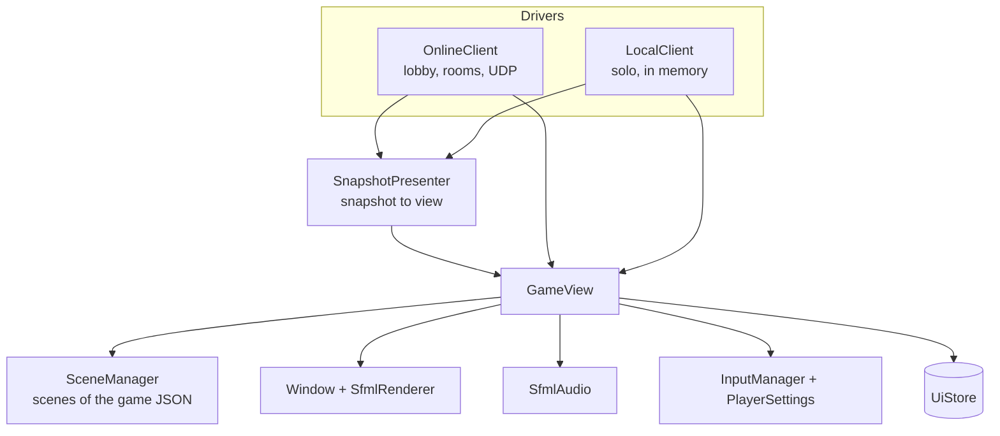

# Client

The client side is made of a **view**, which can show any game from its JSON, and a **driver**, which decides
where the game state comes from.



## Classes

| Class | File | Role |
|---|---|---|
| `GameView` | `client/` | Opens the window, loads textures, fonts and sounds, builds scenes, runs the client systems, syncs remote entities. Split in `GameView.cpp` and `GameViewSync.cpp` |
| `SceneManager` | `client/` | Switches scenes: destroys the entities of the old scene, spawns the new one, builds its systems, plays its music |
| `SnapshotPresenter` | `client/` | Applies a `SNAPSHOT` to the view: creates, moves and removes entities, writes world and player values in the `UiStore` |
| `OnlineClient` | `client/` | Driver for online play: connection, lobby, rooms, pause, console. Split in `OnlineClient.cpp`, `OnlineClientLobby.cpp`, `OnlineClientGame.cpp` |
| `LocalClient` | `local/` | Driver for solo play, see [Solo mode](solo-mode.md) |
| `PlayerSettings` | `client/` | Reads `<game>_settings.json`: controls, gamepad, volumes, text scale |
| `DevConsole` | `client/` | The F1 console: local commands and server commands |
| `DebugMetrics` | `client/` | The F3 overlay: FPS, ping, entities, memory, bandwidth, ping history |
| `ClientConnection` | `network/client/` | The UDP side: connect, heartbeat, input, events and snapshot buffering |

## Scenes

A scene is declared in the `scenes` block of the game file. R-Type has `loading`, `menu`, `lobby`, `room` and
`game`; Skyhop has `menu` and `game`.

```json
"game": {
    "music": "main",
    "escapeAction": "pause",
    "systems": ["Parallax", "SpriteAnimation", "DeathEffect", "Audio", "Cleanup"],
    "entities": [
        {"prefab": "star_far", "count": 120, "scatter": true},
        {"prefab": "hud_line", "components": {"Transform": {"x": 24, "y": 12}, "Text": {...}}}
    ]
}
```

| Key | Meaning |
|---|---|
| `music` | Music key played while the scene is active |
| `escapeAction` | Action triggered by Escape (or the gamepad Select button) |
| `systems` | Client systems of the scene, in order |
| `entities` | Entities to spawn: a prefab, optional extra `components`, optional `count` and `scatter` |

On start, the view shows `loadingScene` while it loads the textures and sounds listed in `preload`, for at
least `loadingMinSeconds`, then switches to `startScene`.

## Online client flow

| Scene | What happens | Actions handled by `OnlineClient` |
|---|---|---|
| `menu` | Title screen | `connect`, `quit` |
| `lobby` | Room list, refreshed every 2 seconds, create or join | `create_room`, `join:<id>`, `join_code`, `refresh_rooms`, `disconnect` |
| `room` | Seats, owner can kick and start | `start_game`, `kick:<slot>`, `leave_room`, `delete_room` |
| `game` | Game, pause menu, console | `pause`, `resume`, `leave_room` |

Buttons only carry an action string (`"Button": {"action": "create_room"}`): the screens themselves are pure JSON.

## Remote entities

For each `EntityState` of a snapshot, the view looks up the client prefab named by `kinds` and creates it the
first time the id appears. It then updates its position, its rotation and its hit flash. An entity absent from
the snapshot is removed. On `ENTITY_DESTROYED`, the view plays the `DeathEffect` of the entity (explosion,
particles) before removing it.

## UI values written by the client

| Key | Value |
|---|---|
| `world.<name>` | Each world value, or its label |
| `player<N>.present`, `.alive`, `.health`, `.score`, `.<value>` | Status of seat N |
| `game.phase` | `waiting`, `playing` or `over` |
| `game.notice` | For 4 seconds, "P2 LOST THE CONNECTION" when a player leaves or crashes (`uiMessages` `playerLeft`, `playerLost`) |
| `pause.visible`, `console.visible`, `debug.visible` | `yes` or `no` |
| `lobby.status`, `lobby.error`, `room.error` | Messages from `uiMessages` |

## Console (F1)

The console is available in the room and game scenes.

| Command | Where | Effect |
|---|---|---|
| `help`, `clear` | client | Help, clear the lines |
| `cvars`, `get <cvar>`, `set <cvar> <value>` | client | Settings: `musicVolume`, `soundVolume`, `showMetrics` |
| anything else | server | Sent as `CONSOLE_COMMAND`, run by the game's console script (room owner, cheats ON) |

R-Type's server commands are listed in [Console and cheats](../guides/content/console.md).
