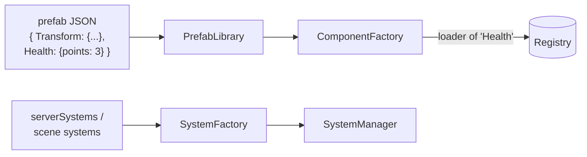

# Data-driven games

A game is a set of files loaded at run time. Changing a level, an enemy, a menu or a rule never requires
recompiling the engine.

## Files of a game

For a game called `<game>` (R-Type: `rtype`, Skyhop: `skyhop`):

| File | Read by | Contents |
|---|---|---|
| `data/<game>_game.json` | server, client, solo | The main file: window, world size, network settings, layers, values, rules, systems, textures, sounds, scenes, HUD |
| `data/<game>_server_prefabs.json` | simulation | Templates of the entities that exist in the simulation (gameplay components) |
| `data/<game>_client_prefabs.json` | client | Templates of how each entity looks (sprites, animations, sounds) and of UI elements |
| `data/<game>_settings.json` | client | Player settings: controls, gamepad, volumes, text scale |
| `scripts/*.py` | simulation | Python behaviours attached with `Script` components |
| `assets/` | client | Images, sounds, music, fonts (R-Type: `game/assets/rtype/`) |

The file names of the prefabs, settings and scripts folder are given in the `files` block of the game file, so a
game may organise them differently. Every key of the game file is described in the
[Game file reference](../reference/game-file.md).

## From JSON to entities

1. `DataNode` (`scene/include/DataNode.hpp`) reads JSON and gives typed access. Every error names the file
   and the path of the faulty value, for example `DataNode: <path> must be an object`.
2. `ComponentFactory` maps a component name to a **loader**. The loaders of every engine component are in
   `scene/src/EngineComponentLoaders*.cpp`.
3. `PrefabLibrary` keeps the prefabs and spawns an entity by name, running the loader of each component.
4. `SystemFactory` maps a system name to a **builder** (`scene/src/EngineSystemBuilders.cpp`). The builder
   receives a `SystemContext` that gives access to the registry, event queues, prefabs, renderer, audio...
5. `SceneBuilder` spawns the entities listed by a scene (`serverScene`, or the `entities` of a client scene),
   with optional `count` and `scatter` to place many copies at random.

## Server side and client side

The same game has two views of each entity:

| | Server prefab (`rtype_server_prefabs.json`) | Client prefab (`rtype_client_prefabs.json`) |
|---|---|---|
| Purpose | Gameplay | Appearance |
| Typical components | `Transform`, `Velocity`, `Collider`, `Health`, `Weapon`, `Script`, `Replicated` | `Transform`, `Sprite`, `SpriteAnimation`, `SoundCue`, `DeathEffect` |
| Link | `"Replicated": {"kind": 3}` | entry `"3": "bydo"` of the `kinds` table in the game file |

Only entities with `Replicated` are sent in snapshots. The client creates the client prefab whose name the
`kinds` table gives for that number.

## Values shared with the HUD

The simulation exposes numbers to the client through three tables declared in the game file:

| Table | Set by | Shown as |
|---|---|---|
| `worldValues` | scripts: `world.set("stage", 2)`, `world.set_label("phase", "boss")` | `{world.stage}`, `{world.phase}` |
| `playerValues` | scripts: `e.set_player_value("weapon", 1)` | `{player0.weapon}` |
| `rules` | the room creator in the lobby | read by scripts: `world.rule("difficulty")` |

A value may have `labels`: it is then sent as an index and shown as its label (`"phase": 2` is shown as
`"boss"`). See [World values, player values and rules](../guides/content/values-and-rules.md).

## What a game cannot do without C++

The data model covers everything the existing components and systems can express. A behaviour that none of them
provides is first written in Python. Only when a feature is generic and needed by several games is it added to
the engine as a component or a system ([Add a component](../guides/engine/add-a-component.md),
[Add a system](../guides/engine/add-a-system.md)).
