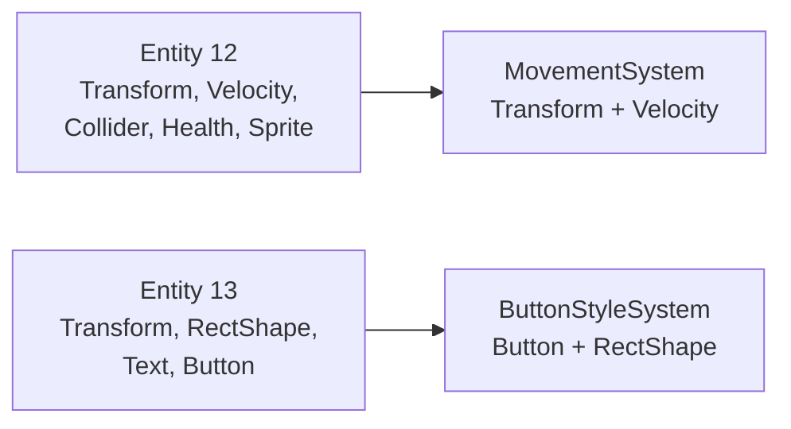

# Entity Component System

Every game object, from a ship to a button of the menu, is an **entity**: an id with **components** attached.
Components are plain data. **Systems** hold the logic: each one updates the entities that have a given set of
components.



Composition replaces inheritance: an enemy that shoots is an entity with a `Weapon`, an enemy that does not
shoot is the same without it. New behaviours come from new combinations of components, written in JSON.

## Entity

`Entity` (`ecs/include/Entity.hpp`) is a small handle made of an **index** and a **generation**. When an
entity is destroyed, its index is reused by the next one with a higher generation, so an old handle can never
reach the new entity by mistake (`Registry::isAlive` compares both).

## Registry

`Registry` (`ecs/include/Registry.hpp`) owns the entities and one storage per component type.

| Call | Effect |
|---|---|
| `registerComponent<T>()` | Declares a component type (done once, for every engine component, by `registerEngineComponents`) |
| `spawn()` | Creates an entity |
| `kill(entity)` | Removes the entity and all its components immediately |
| `emplace<T>(entity, args...)` | Adds `T`, or **replaces** it if the entity already has one |
| `remove<T>(entity)` | Removes `T` |
| `has<T>(entity)`, `get<T>(entity)` | Tests and reads a component |
| `view<A, B, ...>()` | Indices of the alive entities that have all the listed components |
| `getComponents<T>()` | The storage of `T`, for fast loops |

```cpp
for (std::size_t i : registry.view<Transform, Velocity>()) {
    Transform &transform = transforms.at(i);
    transform.translate(velocities.at(i).x() * dt, velocities.at(i).y() * dt);
}
```

### Storage

Each component type is stored in a `SparseArray<T>`: a `std::vector<std::optional<T>>` indexed by entity index.
Access by entity is direct, and memory is contiguous, which suits loops over many entities.

The registry also keeps a 64-bit **component mask** per entity (one bit per registered type). `view` filters
entities by comparing masks, without touching the component data. A game can therefore use up to 64 component
types, the engine registers about 60.

### Destroying entities during a frame

Systems do not call `kill` while other systems may still look at the entity. They add the `Destroyed` tag
instead. `Destroyed::isActive(registry, entity)` tells whether an entity is alive and not tagged.
The cleanup step at the end of the frame kills every tagged entity, after the systems that react to deaths
(lives, score, death effects, scripts' `on_death`) have run.

## Components

Every component derives from `IComponent` and lives in `ecs/components/<category>/`:

| Category | Examples |
|---|---|
| `physics` | `Transform`, `Velocity`, `Collider`, `Bounded`, `Solid`, `Gravity`, `Bounce`, `Attachment`, `Rotation` |
| `combat` | `Health`, `ContactDamage`, `Invulnerable`, `Destroyed`, `Owner`, `ScoreValue`, `Weapon`, `HitFlash` |
| `gameplay` | `Player`, `PlayerControl`, `Lives`, `Score`, `Respawn`, `Match`, `Script`, `Tilemap`, `Replicated` |
| `presentation` | `Sprite`, `SpriteAnimation`, `Text`, `RectShape`, `Parallax`, `ParticleEmitter`, `SoundCue`, `MusicWhen` |
| `interface` | `Button`, `Focusable`, `TextField`, `Choice`, `VisibleWhen`, `BoundText`, `ListView`, `ProgressBar` |

The complete list, with the JSON fields of each one, is in the [Component reference](../reference/components.md).

## Systems

A system implements `ISystem`:

```cpp
class ISystem
{
public:
    virtual ~ISystem() = default;
    virtual void update(float dt) = 0;
};
```

Systems receive what they need in their constructor (the registry, an event queue, the renderer...) and keep
references to it. A `SystemManager` holds them and calls `update` **in the order they were added**. That order
comes from the game JSON (`serverSystems` for the server, `systems` of each scene for the client), so a game
chooses which systems run and in which order. See the [System reference](../reference/systems.md).

## Events

Systems talk to each other through typed queues, `EventQueue<T>` (`core/include/EventQueue.hpp`):

| Event | Pushed by | Read by |
|---|---|---|
| `CollisionEvent` | `CollisionSystem` | `DamageSystem`, scripts (`on_contact`) |
| `DeathEvent` | `DamageSystem`, scripts | `LivesSystem`, `ScoreSystem`, scripts (`on_death`) |
| `SoundEvent` | scripts (`play_sound`) | the simulation, which sends `PLAY_SOUND` |
| `ConsoleEvent` | console commands | the console script |
| `UiActionEvent` | `PointerSystem`, `FocusNavigationSystem` | `OnlineClient`, `LocalClient` |

Queues are cleared once per tick, after every system has read them.

## UI store

The client keeps a `UiStore` (`ecs/include/UiStore.hpp`): a table of string values (`"world.stage"`,
`"player0.score"`, `"pause.visible"`...) and of lists (rooms, members). Interface components read it:
`BoundText` formats text with `{key}`, `VisibleWhen` shows an entity when a key has a value, `ProgressBar`
draws a ratio. The client code only writes values, it never touches the UI entities themselves.
This keeps menus and HUD entirely in JSON.
