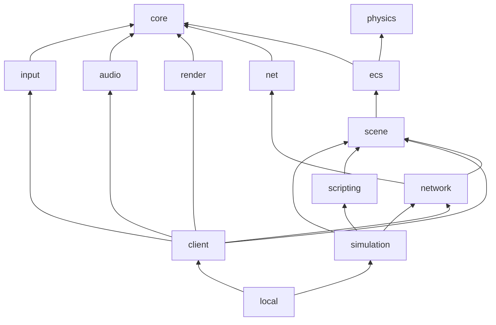

# Engine modules

Each module lives in `engine/<module>/` with an `include/` and a `src/` folder, and is built as its own static
library. Third-party libraries stay **private** to the module that wraps them, so the rest of the engine never
sees SFML, Asio, nlohmann-json or pybind11.

## Module list

| Library | Folder | Provides | Depends on |
|---|---|---|---|
| `engine_core` | `core/` | `EngineError` (base of every exception), `DynamicLibrary`, `Clock`, `FixedTimestep`, `EventQueue`, `Color`, `Vector2`, `IntRect`, `CommandLine`, `AssetPath`, `UiInput`, `ProcessMemory` | - |
| `engine_physics` | `physics/` | `Aabb` (overlap and separation), `Body`, `CollisionPair`, collision detection | - |
| `engine_ecs` | `ecs/` | `Registry`, `SparseArray`, `Entity`, `ISystem`, `SystemManager`, `UiStore`, all the engine components and systems | core, physics |
| `engine_scene` | `scene/` | `DataNode` (JSON reader), `DataWriter`, `PluginManager`, `ComponentFactory`, `SystemFactory`, `PrefabLibrary`, `SceneBuilder`, the loaders of every component and system | core, ecs, nlohmann-json (private) |
| `engine_net` | `net/` | `UdpTransport` (socket + I/O thread), `Endpoint`, `Datagram`, big-endian `ByteWriter` / `ByteReader` | core, Asio (private) |
| `engine_network` | `network/` | The game protocol (`Packet`, `Codec`, every message), `GameServer`, `GameRoom`, `ClientConnection`, `NetworkSettings` | core, net, scene |
| `engine_render` | `render/` | `Window`, `IRenderer`, `SfmlRenderer`, `TextureManager`, `FontManager` | core, SFML Graphics |
| `engine_audio` | `audio/` | `IAudio`, `SfmlAudio` (sounds and music) | core, SFML Audio |
| `engine_input` | `input/` | `Action`, `KeyBindings`, `InputManager` | core, SFML Window |
| `engine_client` | `client/` | `GameView` (window, resources, scenes), `OnlineClient`, `SnapshotPresenter`, `DevConsole`, `DebugMetrics`, `PlayerSettings` | scene, network, render, audio, input |
| `engine_scripting` | `scripting/` | `ScriptEngine`, `ScriptSystem`, the Python API (`ScriptWorld`, `ScriptEntity`) | scene, pybind11 (private) |
| `engine_simulation` | `simulation/` | `Simulation` (authoritative world of one game), `SimulationFactory` | scene, network, scripting |
| `engine_local` | `local/` | `LocalClient` (solo mode) | client, simulation |



## Folders inside the big modules

The ECS and the network modules group their files by category:

| Folder | Categories |
|---|---|
| `ecs/components/` | `physics`, `combat`, `gameplay`, `presentation`, `interface` |
| `ecs/systems/` | `events`, `physics`, `gameplay`, `presentation`, `interface` |
| `network/messages/` | `connection`, `lobby`, `game`, `console` |
| `network/` | `protocol`, `messages`, `server`, `client` |

Each category has its own `include/` and `src/`. File names are unique in the whole engine, so includes are
written without a path: `#include "Health.hpp"`.

## Build options and launchers

| CMake option | Default | Effect |
|---|---|---|
| `ENGINE_BUILD_CLIENT` | `ON` | Builds render, audio, input, client and the client executables |
| `ENGINE_BUILD_SERVER` | `ON` | Builds scripting, simulation and the server executables |

**Run-time modularity**: systems can also live in plugins, shared libraries loaded and reloaded while the game
runs ([Write a plugin](../guides/engine/write-a-plugin.md)). The engine libraries are built as position-independent code
so that plugins can link them.

A dedicated server machine can be built with `-DENGINE_BUILD_CLIENT=OFF`: it then needs neither SFML nor a
display. The solo executables need both options.

The launchers in `engine/apps/src/` are generic. `engine_add_game` compiles them once per game with two
definitions, `ENGINE_PROGRAM_NAME` and `ENGINE_DEFAULT_GAME`:

| Launcher | Built when the game declares | Runs |
|---|---|---|
| `ServerMain.cpp` | `SERVER <name>` | `GameServer` + `SimulationFactory` + `ServerRunner` |
| `ClientMain.cpp` | `CLIENT <name>` | `OnlineClient` |
| `LocalMain.cpp` | `LOCAL <name>` | `LocalClient` |

Every launcher accepts `-g <game>` to load another game's data from the same folder.

## Rules

- No engine file includes a file from a game folder. Games are loaded at run time.
- A wrapped library never appears in a public header of the engine. Implementation details that need it live
  in an `internal/` folder (`net/internal`, `scene/internal`, `scripting/internal`).
- `engine_physics` does not depend on the ECS: it works on plain rectangles.
- The server never links rendering, audio or input.

## Errors

Every module has its own exception class, all deriving from `engine::EngineError`:

```text
std::exception
└── engine::EngineError                 core
    ├── engine::CoreError               core
    ├── engine::ecs::EcsError           ecs
    ├── engine::scene::SceneError       scene
    ├── engine::net::NetError           net
    ├── engine::render::RenderError     render
    ├── engine::audio::AudioError       audio
    ├── engine::input::InputError       input
    ├── engine::client::ClientError     client
    ├── engine::scripting::ScriptError  scripting
    └── engine::simulation::SimulationError  simulation
```

Messages start with the name of the class that raised them (`"Registry: component type not registered"`).
Every launcher catches `EngineError`, then `std::exception`, prints the message and exits with code **84**.

## Time

`Clock::restart()` returns the seconds elapsed since the previous call, measured with `std::chrono::steady_clock`.
`FixedTimestep` accumulates that time and releases it in fixed steps:

```cpp
timestep.addTime(clock.restart());
while (timestep.step())
    server.tick(timestep.stepSeconds());
```

The simulation always advances by the same `dt` (1/60 s), whatever the CPU speed. A frame adds at most 0.25 s,
so a long freeze cannot cause an endless catch-up.
