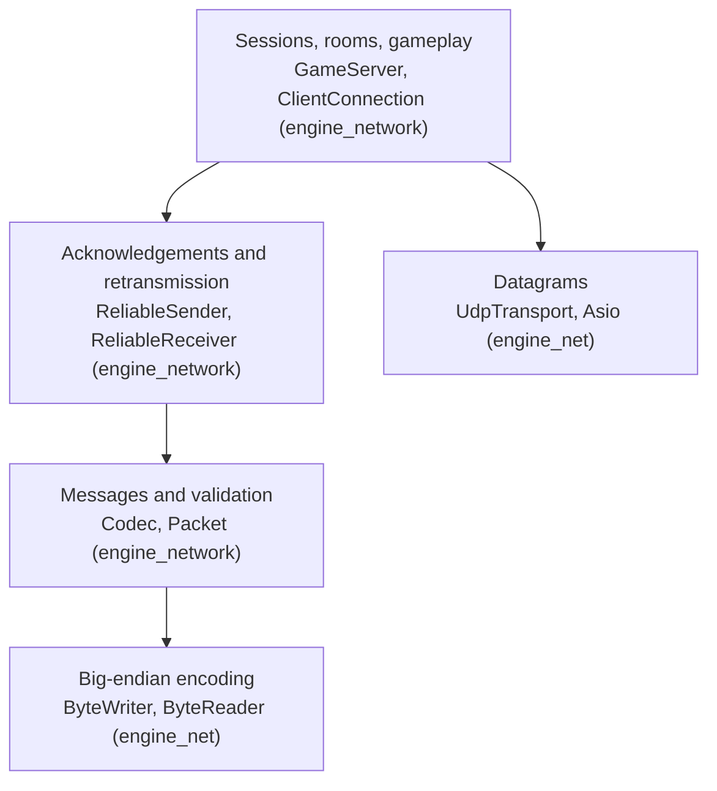

# Networking

How the network code is organised. The byte-level contract is the [protocol](../reference/protocol.md).

## Four levels

| Level | Knows | Does not know |
|---|---|---|
| `UdpTransport` | Endpoints and byte buffers | Message types |
| `ByteWriter` / `ByteReader` | Integers in network byte order, size limits | What the integers mean |
| `Codec` | Every message type and its validation rules | Sessions, timing |
| `ReliableSender` / `ReliableReceiver` | Which packets arrived, what to resend | What a message means |
| `GameServer` / `ClientConnection` | Tokens, rooms, timers, gameplay | Sockets |

The engine knows nothing about R-Type: message types and sizes are generic, and the number of
world and player values comes from the game's JSON configuration.

## Transport

`UdpTransport` wraps an IPv4 UDP socket (Asio, hidden in `net/internal`). A background thread receives
datagrams and puts them in a queue; the main thread takes them with `poll()`.

- `send(peer, bytes)` queues an asynchronous send and returns immediately.
- `poll()` returns every datagram received since the previous call, without waiting.
- Datagrams larger than 1200 bytes are dropped; at most 256 received datagrams and 256 pending
  sends are kept, after which datagrams are discarded rather than growing the queue.
- An exception on the I/O thread is stored and rethrown on the main thread at the next call.

Asio is a private dependency of `engine_net`, hidden behind a private implementation class, so
no game file includes it.

## Reliability

UDP may lose, duplicate, reorder or delay datagrams. The protocol does not retransmit
everything: it retransmits only what cannot be reconstructed from later traffic.

| Data | Strategy |
|---|---|
| Player input | Full button state ~30 times per second; a lost packet is replaced by the next |
| World state | Snapshot 20 times per second; a lost snapshot is replaced by the next |
| Game events | Acknowledged and retransmitted until confirmed |
| Lobby actions | Acknowledged and retransmitted until confirmed |
| Session liveness | Heartbeat every second, 5 s timeout on both sides |

Every packet header carries `ack` and `ackBits`, so acknowledgements travel on traffic that is
sent anyway and never cost a dedicated packet. A reliable message keeps a stable `reliableId`
across its retransmissions, which lets the receiver discard a late original after its
replacement has been applied.

The retransmission delay is `max(100 ms, smoothed round-trip time x 1.5)`. The round-trip time
is derived from acknowledgements, so the server measures it per client without sending anything
extra.

See [the protocol](../reference/protocol.md#4-reliability) for the exact rules.

## Snapshots and deltas

The simulation always produces a complete snapshot. The server encodes it as a difference
against the most recent snapshot **that the client has acknowledged**, and the client rebuilds a
complete snapshot before handing it to the renderer. Neither the simulation nor the client view
code is aware that deltas exist.

A full snapshot is sent when there is no acknowledged baseline, when the baseline is more than
one second of ticks old, or every five seconds as a keyframe, which bounds the lifetime of any
undetected desynchronisation.

## Measurements

Measured with `scripts/protocol_probe.py`, two players, light scene of about 14 entities.

| Message | Size | Rate |
|---|---|---|
| `INPUT` | 25 bytes | ~30/s per client |
| `HEARTBEAT` | 28 bytes | 1/s per client |
| `SNAPSHOT` (full) | 102 + 8 x entities bytes | keyframe only |
| `SNAPSHOT_DELTA` | 105 bytes on average, 33 minimum | 20/s per client |

| Snapshot encoding | Average size | Ratio |
|---|---|---|
| Full snapshot, every time | 223 bytes | baseline |
| Delta, world and player changes only | 130 bytes | x1.7 |
| Delta with compact entity changes | **105 bytes** | **x2.1** |

About 16 kbit/s downstream per client in a light scene, against 34 kbit/s before the delta work.

Reliability verified with simulated loss: at 60 % packet loss a client receives exactly the same
set of game events as a lossless reference client. The `build` and `apply` round trip was
verified on 1218 consecutive snapshots with no mismatch.
