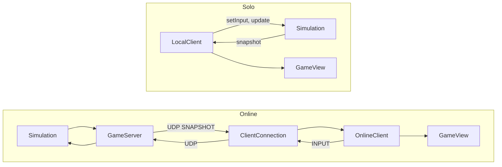
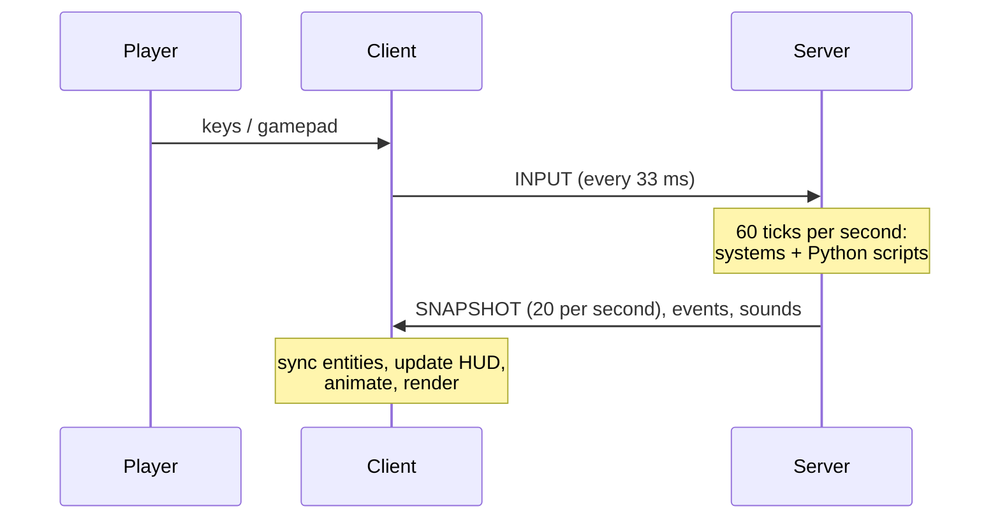

# Architecture overview

## The big picture

The repository contains **one engine** and **games built on it**. The engine is written in C++ and knows nothing
about any particular game. A game is a folder of **data**: JSON files that describe entities, scenes and HUD, and
Python scripts that describe behaviours. No game contains C++ code.

```mermaid
flowchart TB
    subgraph Games["Games (data only)"]
        direction LR
        RType["game/ - R-Type<br/>JSON + Python + assets"]
        Skyhop["game2/ - Skyhop<br/>JSON + Python + assets"]
    end
    subgraph Apps["Launchers (engine/apps)"]
        direction LR
        ServerMain["ServerMain<br/>r-type_server"]
        ClientMain["ClientMain<br/>r-type_client"]
        LocalMain["LocalMain<br/>skyhop"]
    end
    subgraph High["High-level engine modules"]
        direction LR
        Simulation["simulation<br/>authoritative world"]
        Client["client<br/>window, scenes, HUD"]
        Local["local<br/>solo mode"]
        Network["network<br/>protocol, server,<br/>client connection"]
        Scripting["scripting<br/>embedded Python"]
    end
    subgraph Base["Base engine modules"]
        direction LR
        Scene["scene<br/>JSON, factories,<br/>prefabs"]
        ECS["ecs<br/>registry, components,<br/>systems"]
        Physics["physics<br/>AABB"]
        Net["net<br/>UDP, bytes"]
        Render["render<br/>SFML graphics"]
        Audio["audio<br/>SFML audio"]
        Input["input<br/>bindings"]
        Core["core<br/>errors, time,<br/>geometry"]
    end
    Games -->|loaded at run time| Apps
    Apps --> High
    High --> Base
```



| Folder | Contents |
|---|---|
| `engine/` | The engine: one CMake library per module, plus the generic launchers in `engine/apps/` |
| `game/` | R-Type: `data/` (JSON), `scripts/` (Python) |
| `game2/` | Skyhop: `data/`, `scripts/skyhop/`, `assets/skyhop/` |
| `game/assets/rtype/` | R-Type sprites, backgrounds, sounds, music and fonts |
| `docs/` | This documentation (MkDocs website) |
| `scripts/` | Helper shell scripts (`play.sh`) |

The root `CMakeLists.txt` only declares the games:

```cmake
add_subdirectory(engine)

engine_add_game(rtype
    CLIENT r-type_client
    SERVER r-type_server
    DATA game/data
    SCRIPTS game/scripts
    ASSETS assets)

engine_add_game(skyhop
    LOCAL skyhop
    DATA game2/data
    SCRIPTS game2/scripts
    ASSETS game2/assets)
```

`engine_add_game` builds the generic launchers with the game name compiled in, and copies the game's data,
scripts and assets next to the executables. See [Engine modules](engine-modules.md).

## Three ways to run a game

The same simulation and the same display code are combined in three ways:

| Mode | Executable | Simulation runs in | Display runs in | Link |
|---|---|---|---|---|
| Server | `r-type_server` | the server process | - | - |
| Online client | `r-type_client` | - | the client process | UDP, [protocol](../reference/protocol.md) |
| Solo | `skyhop` | the same process | the same process | direct function calls |



The transport is interchangeable because both sides only exchange two things: **button states** going in and
**snapshots** coming out. See [Solo mode](solo-mode.md).

## Runtime model (online)

The server owns the truth. Clients send the buttons they hold, the server simulates the world at 60 ticks per
second and sends its state 20 times per second, as a delta against the last snapshot the client acknowledged. Clients draw what they receive, plus local cosmetic
effects (parallax, animations, particles).



## One server tick

1. `GameServer::poll()` drops silent clients and decodes every received datagram.
2. `GameServer::tick()` runs each playing room: inputs older than 500 ms are released, then
   `Simulation::update()` runs the server systems listed in the game's `serverSystems`, in that order
   (R-Type: PlayerControl, Weapon, Invulnerability, Movement, Tilemap, Attachment, Solid, Bounds, Collision,
   Damage, HitFlash, Script, Lives, Score, Offscreen, Match, Respawn).
3. Events produced by the tick (entity destroyed, player killed, sounds, console replies) are sent to the room.
4. Every third tick, a snapshot is sent to every member of the room.

## One client frame

1. Window, keyboard and gamepad events are read.
2. `ClientConnection` receives datagrams and sends `INPUT` and `HEARTBEAT` when due.
3. The newest snapshot is applied: entities are created, moved or removed, the HUD values are updated.
4. The client systems of the current scene run (UI, animations, particles, audio).
5. `RenderSystem` draws the scene.

## Ownership

| Data | Owner | Thread |
|---|---|---|
| UDP socket and receive queue | `UdpTransport` | network I/O thread |
| Sessions, tokens, rooms | `GameServer` | server main thread |
| Game world of one room | `Simulation` (one per room) | server main thread |
| Python interpreter | `ScriptEngine` | server main thread |
| Window, textures, client world, UI values | `GameView` | client main thread |
| Wire format | `engine::network` | - |

Read next: [Engine modules](engine-modules.md), [ECS](ecs.md), [Data-driven games](data-driven.md),
[Scripting](scripting.md), [Server](server.md), [Client](client.md), [Networking](networking.md).
