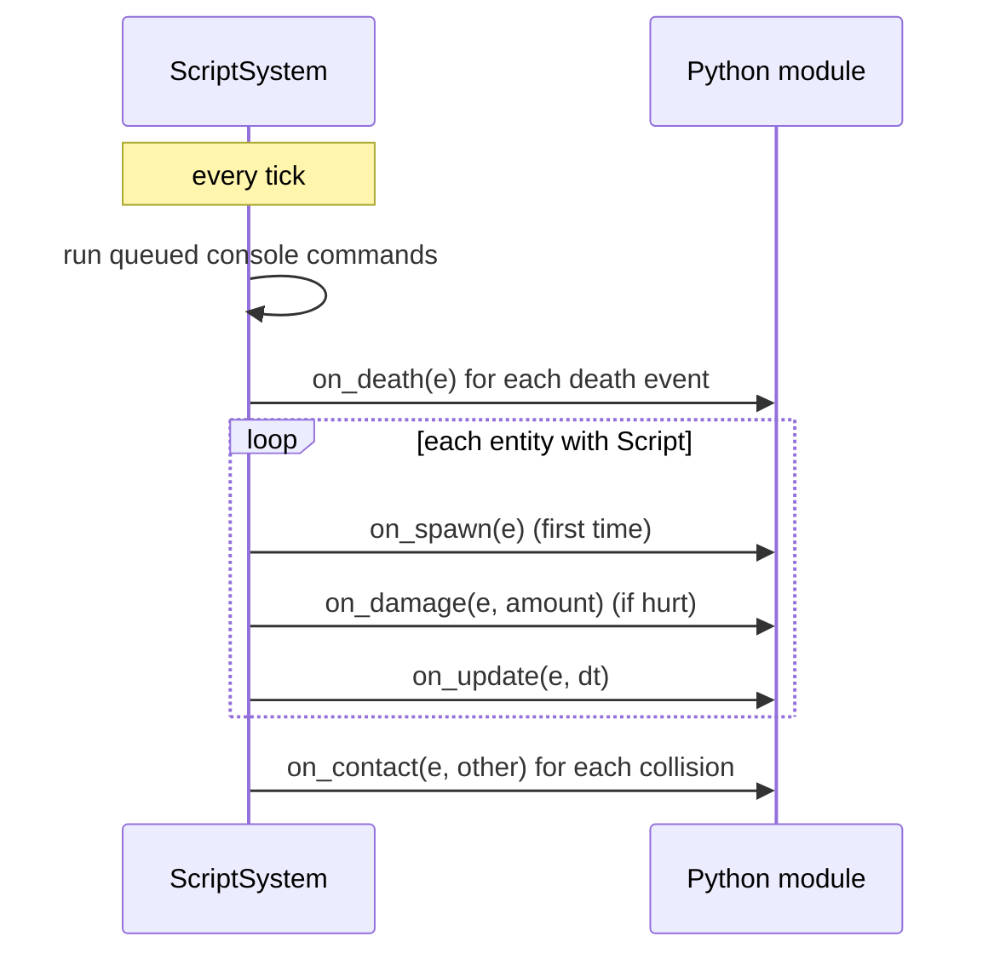

# Scripting

Behaviours that are specific to a game (enemy patterns, stage timelines, bosses, power-ups) are written in
**Python 3**, embedded in the server with **pybind11**. Scripts only run in the simulation (server or solo
mode), never in the online client.

## Pieces

| Class | Folder | Role |
|---|---|---|
| `ScriptEngine` | `scripting/include` | Starts one Python interpreter for the process, loads script files as modules |
| `ScriptSystem` | `scripting/include` | The `Script` system: calls the hooks of every scripted entity, every tick |
| `ScriptWorld` | `scripting/include` | The `world` object given to scripts: time, spawning, world values, rules, sounds |
| `ScriptEntity` | `scripting/include` | The handle `e` given to scripts: position, velocity, health, weapons, inputs... |
| `ScriptEngineImpl`, `ScriptSystemImpl` | `scripting/internal`, `scripting/src` | The pybind11 code, hidden from the rest of the engine |
| `ScriptApiBindings.cpp` | `scripting/src` | The list of every function visible from Python |

The interpreter uses the Python standard library copied next to the executable at build time
(`engine_python_runtime` target), so players do not need Python installed.

## Attaching a script

```json
"bydo_sine": {
    "Transform": {}, "Velocity": {"x": 0, "y": 0},
    "Collider": {"width": 66, "height": 72, "layer": "enemy", "hits": ["player"]},
    "Health": {"points": 1},
    "ContactDamage": {"amount": 25, "destroyOnHit": true},
    "ScoreValue": {"points": 100},
    "Script": {"file": "bydo.py", "params": {"pattern": "sine", "amplitude": 150, "frequency": 3}},
    "Replicated": {"kind": 3}
}
```

`file` is relative to the game's scripts folder (`files.scripts` in the game file). `params` are read by the
script with `e.number("amplitude", 150.0)` and `e.text("pattern", "straight")` (the second argument is the default).

## Hooks

A script is a module with optional functions. The engine calls them with the entity handle `e`:

| Hook | Called |
|---|---|
| `on_spawn(e)` | Once, the first tick the entity is seen |
| `on_update(e, dt)` | Every tick while the entity is alive |
| `on_damage(e, amount)` | When its health went down since the previous tick |
| `on_death(e)` | When it was killed (damage or `e.kill()`) |
| `on_contact(e, other)` | When its collider touched another entity |

The console has its own entry point: the game's console script defines `run(world, ship, text)`, which returns
the text to print in the console.



## One module, many entities

A file is imported once and shared by all entities that use it. Per-entity state is stored **on the handle**:
the engine keeps one handle per entity, and handles accept new attributes.

```python
def on_spawn(e):
    e.pattern = e.text("pattern", "straight")

def on_update(e, dt):
    if e.pattern == "sine":
        common.sine(e, e.number("amplitude", 150.0), e.number("frequency", 3.0))
```

(from `game/scripts/bydo.py`)

Module-level variables are shared by every entity using the file: use them only for constants.

## Errors

A Python exception never stops the game. The engine prints the traceback on the error output, prefixed with
`[script]`, and **disables that script for that entity only**:

```text
[script] bydo.py on_update failed, script disabled for this entity:
NameError: name 'speeed' is not defined
```

A file that cannot be loaded (missing, syntax error) is reported the same way, with the hook `load`.

## Full API

Every function available to scripts is listed in the [Scripting reference](../reference/scripting-api.md).
