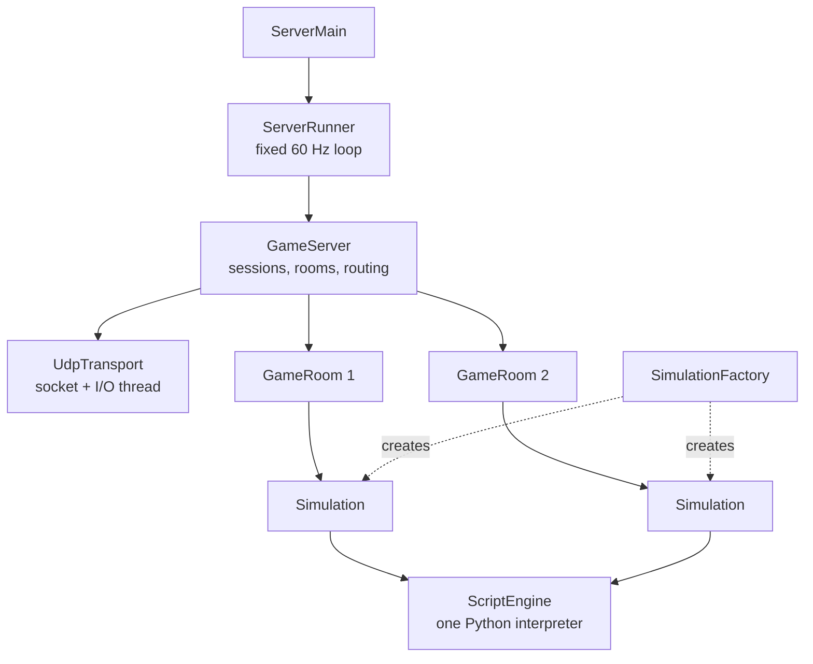

# Server

The server executable (`r-type_server`) is built from `engine/apps/src/ServerMain.cpp`. It contains no R-Type
code: it loads the game named at compile time (or given with `-g`) and runs it for every room.



## Classes

| Class | File | Role |
|---|---|---|
| `ServerRunner` | `network/server/` | Main loop: `poll()` the network, run `tick()` at a fixed rate, stop on Ctrl+C (`SIGINT`, `SIGTERM`) |
| `GameServer` | `network/server/` | Decodes datagrams, owns sessions and rooms, sends packets. Split in `GameServer.cpp` (sessions) and `GameServerRooms.cpp` (rooms) |
| `ClientSession` | `network/server/` | One connected client: address, token, last sequences, timers, room, failed join attempts |
| `GameRoom` | `network/server/` | Seats, owner, code, rules, queued console commands, and the game session of the room |
| `IGameSession`, `ISessionFactory` | `network/server/` | Interfaces between the network layer and the game: the server only knows "add a player, set its input, update, snapshot" |
| `Simulation` | `simulation/` | Implements `IGameSession`: the world of one room, built from the game JSON |
| `SimulationFactory` | `simulation/` | Implements `ISessionFactory`: creates a `Simulation` with the rules chosen by the room creator |

`engine_network` does not depend on `engine_simulation`: the two interfaces let another kind of game session be
plugged into the same server.

## Main loop

```cpp
while (running) {
    server.poll();                       // timeouts + received datagrams
    timestep.addTime(clock.restart());
    while (timestep.step())
        server.tick(timestep.stepSeconds());  // every playing room advances 1/60 s
    sleep(IDLE_DELAY);
}
server.shutdown();                       // SERVER_SHUTDOWN to every client
```

## Simulation of a room

When a room starts its game, every seated player is added to its `Simulation`. Each tick:

1. Queued console commands are released.
2. The systems of `serverSystems` run in order.
3. New replicated entities receive a network id (never 0, unique).
4. Deaths become `ENTITY_DESTROYED` and `PLAYER_KILLED` events, script sounds become `PLAY_SOUND`, console
   answers become `CONSOLE_TEXT`.
5. Event queues are cleared, entities tagged `Destroyed` are removed.

`Simulation::snapshot()` builds the `SNAPSHOT`: the world values, one `PlayerStatus` per seat and one
`EntityState` per `Replicated` entity, with the rotation and the hit flash packed in the `visual` byte.

## Players and avatars

A player is an entity created from the game's `playerPrefab` (R-Type: `player`), with `Lives`, `Score` and
`Respawn`. The ship it controls, its **avatar**, is spawned by `RespawnSystem` from the `Respawn.prefab`
(R-Type: `player_ship`). When the avatar dies, the player entity stays: its lives and score survive, and a new
avatar appears after the respawn delay while lives remain.

`MatchSystem` follows the state of the match (`waiting`, `playing`, `over`). When every player is out of lives,
the match is over, and after `restartDelay` seconds the world is cleared (except `Persistent` entities and
entities without `Transform`) and a new round starts.

## Logs

The server writes one line per important event on the standard output:

```text
Server listening on UDP port 4242
Players on your network can join with: -h 192.168.1.67 -p 4242
Client 0 connected
Client 0 created room 1 (FRIENDS)
Room 1 started
New round
Player 0 killed
Game over
Room 1 closed
Client 0 left (reason 1)
```

Script errors are written on the error output with the `[script]` prefix.
