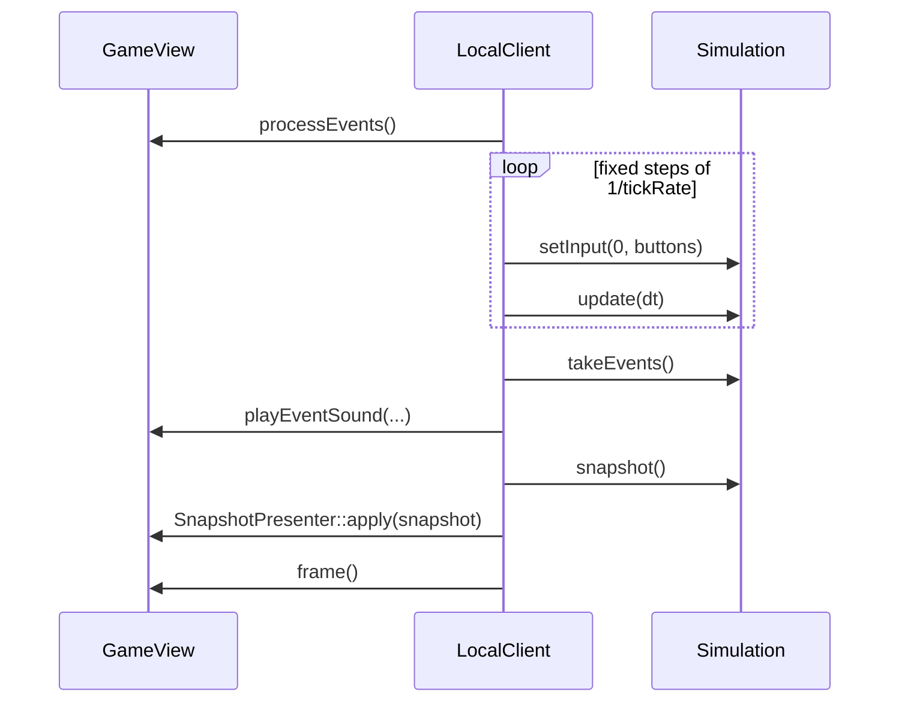

# Solo mode

A game can be played **without any server**. The client then runs the simulation itself, in the same process.
Skyhop uses this mode.

## How it works

`LocalClient` (`engine/local/`) owns a `GameView` and, while a game is running, a `Simulation`. Instead of
sending datagrams, it calls the simulation directly:



The same `Simulation`, the same snapshots and the same `SnapshotPresenter` are used as in online play. Only the
transport changes: function calls instead of UDP. Nothing is encoded, so the solo mode has no network limits.

## Actions

| Action | Effect |
|---|---|
| `play` | Creates a new `Simulation` with default rules, adds player 0, switches to the `game` scene |
| `pause` | Toggles `pause.visible`. The simulation is frozen while paused |
| `resume` | Closes the pause menu |
| `scene:<name>` | Stops the simulation and switches to that scene (for example `scene:menu`) |
| `quit` | Closes the window |

## Making a game playable in solo

1. Declare the game with `LOCAL` in the root `CMakeLists.txt`:

    ```cmake
    engine_add_game(skyhop
        LOCAL skyhop
        DATA game2/data
        SCRIPTS game2/scripts
        ASSETS game2/assets)
    ```

    A game may declare `CLIENT`, `SERVER` and `LOCAL` together to be playable both ways.

2. Give the menu a button with the action `play`, and the game scene an `escapeAction` of `pause`.
3. Build: the executable has the name given after `LOCAL`.

The scene played by `play` is always named `game`. Rules take their first value (index 0).

## Limits

- One player only (slot 0).
- The Python interpreter is started by the executable, so the solo build needs both `ENGINE_BUILD_CLIENT` and
  `ENGINE_BUILD_SERVER`.
