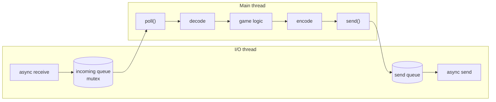

# Threading

The engine uses **two threads per process**, and only one of them touches the game.

| Thread | Created by | Runs |
|---|---|---|
| Main thread | the launcher | Everything: game loop, simulation, Python scripts, rendering, audio, input, packet encoding and decoding |
| Network I/O thread | `UdpTransport` | Asio's event loop: receives datagrams into a queue and performs the queued sends |

## Why this design

- A blocking socket call never freezes the game loop: the main thread only reads a queue.
- The simulation is single-threaded, so it has no locks and is deterministic for a given input sequence.
- Python's interpreter is used from one thread only, which avoids any interaction with its global lock.
- The cost of the simulation is small compared to a frame (a few hundred entities), so parallel systems would
  bring complexity without visible gain.

## Safety rules

- The I/O thread never accesses game data.
- Every I/O handler catches its exceptions; a failure is stored and rethrown on the main thread by
  `poll()`, `send()` or `checkHealth()`.
- Outgoing buffers are owned by the asynchronous operation until it completes.
- The transport destructor waits at most 200 ms for pending sends (for example the final
  `DISCONNECT` or `SERVER_SHUTDOWN`), then stops Asio and joins the thread.
- The server's signal handler only sets a `sig_atomic_t` flag; shutdown runs on the main thread.

## Why the simulation is not parallelised

The server runs every game room on one simulation thread. This is a measured decision, not an
omission.

Per room and per tick, on an Apple M5 with 16 rooms playing:

| Stage | Time |
|---|---|
| C++ simulation (physics, collisions, ECS) | 8 µs |
| **Python scripts** | **24 µs** (73 %) |
| Network encoding | 5 µs |
| **Total** | **37 µs**, against a 16 667 µs tick budget |

Two reasons not to spread rooms over a thread pool:

- Game logic is scripted in Python. Its global interpreter lock serialises bytecode execution,
  so the 24 µs per room would queue up whatever the threading. `engine_scripting` also acquires
  no GIL anywhere, because everything has always run on one thread; calling the interpreter from
  a pool worker without `py::gil_scoped_acquire` is undefined behaviour.
- The arithmetic. On four cores, the best case is `16x24 + 16x13/4 = 436 µs` against 592 µs
  today: **0.9 % of a tick budget**, for a thread pool, GIL handling in every worker, and an
  audit of every structure `tickRoom` touches.

Load measured with `scripts/load_test.py`, which reads the simulation rate from the `tick` field
of snapshots rather than instrumenting the server:

| Concurrent games | 8 | 16 | 32 | 48 | 96 |
|---|---|---|---|---|---|
| Simulation rate seen by clients | 60.0 | 60.0 | 60.0 | 60.0 | **60.0** |

No tick is ever missed. Extrapolating from 37 µs per room, one thread saturates at roughly 450
light games; a four-player room with a boss costs three to four times more, so expect saturation
nearer 120 heavy games.

Should the game logic ever move from Python to C++, the lock would disappear and this trade-off
would be worth revisiting.
