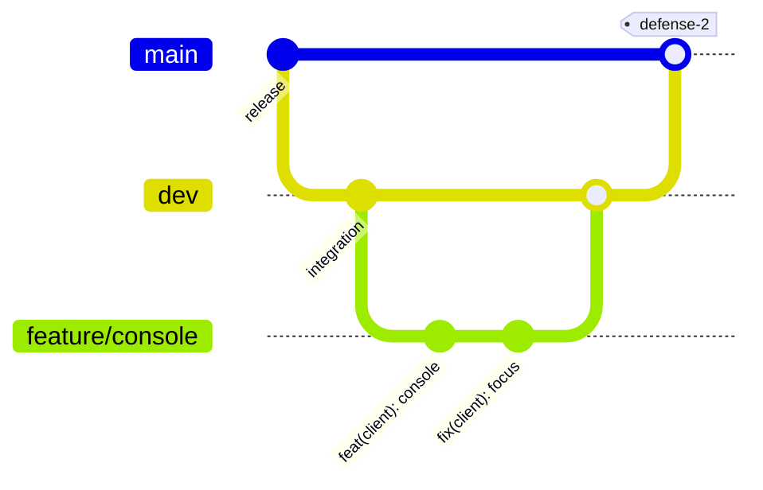

# Git workflow

## Branches



| Branch | Role | Who pushes |
|---|---|---|
| `main` | What is evaluated. Always builds and runs | Merges from `dev` only, decided by the team |
| `dev` | Integration of finished work | Merges of reviewed pull requests |
| `feature/<topic>` | One feature | Its author |
| `fix/<topic>` | One bug fix | Its author |
| `docs/<topic>` | Documentation only | Its author |

Rules:

- Never push directly to `main`.
- One issue, one branch, one pull request. Keep branches short-lived (days, not weeks).
- Before a big refactor, push a backup branch of the starting point (`backup-<topic>`).

## Daily cycle

```sh
git checkout dev
git pull
git checkout -b feature/blinking-text
# work, build, test
git add <files>
git commit -m "feat(ecs): add Blink component and system"
git push -u origin feature/blinking-text
```

Then open a pull request towards `dev`.

## Pull requests

A pull request must:

- pass the CI (format check, Linux and Windows builds);
- follow the [conventions](conventions.md);
- update the documentation it makes wrong (a new component means a new row in the
  [Component reference](../reference/components.md), a protocol change means an RFC update);
- describe what changes and how to test it.

At least one other member reviews it. The author merges after approval, then deletes the branch and closes the
issue (a merge into `dev` does not close it automatically).

## Keeping a branch up to date

```sh
git checkout dev && git pull
git checkout feature/blinking-text
git merge dev
```

Resolve conflicts, rebuild, test, push. Prefer merging `dev` into the branch over rebasing a branch that others
use.

## Undoing things

| Situation | Command |
|---|---|
| Discard local changes of a file | `git restore <file>` |
| Unstage a file | `git restore --staged <file>` |
| Undo the last local commit, keep the changes | `git reset --soft HEAD~1` |
| Undo a pushed commit | `git revert <commit>` (never rewrite pushed history) |
| Go back to a backup | `git checkout backup-<topic>` and open a pull request from it |

## Files that must never be committed

Build folders (`build/`, `out/`), `vcpkg_installed/`, `.vcpkg/`, binaries, IDE settings, and assets without a
license. They are listed in `.gitignore`. Check `git status` before every `git add -A`.
