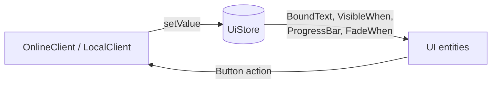

# UI and HUD

Menus, lobby screens, HUD, pause menu and console are entities of the client scenes, written in JSON. The C++
code only writes **values** in the UI store and reacts to **actions** sent by buttons.



## Text

```json
{"prefab": "hud_line", "components": {
    "Transform": {"x": 660, "y": 1010},
    "Text": {"font": "hud", "size": 24, "color": [180, 180, 210, 255]},
    "BoundText": {"format": "STAGE {world.stage}"},
    "Foreground": {}}}
```

`Text.content` is fixed text. `BoundText.format` replaces each `{key}` by its UI value every frame.
`Foreground` draws the entity above the game.

## Showing and hiding

```json
"VisibleWhen": {"key": "world.phase", "value": "boss"}
```

The entity is drawn only while the value matches. A second condition can hide it anyway:

```json
"VisibleWhen": {"key": "world.phase", "value": "ready", "unless": {"key": "pause.visible", "value": "yes"}}
```

Here the "GET READY" text disappears while the pause menu is open. Common keys: `world.phase`, `pause.visible`,
`console.visible`, `debug.visible`, `player0.alive`, `lobby.popup`.

## Bars

```json
"RectShape": {"width": 1000, "height": 20, "color": [255, 70, 70, 255]},
"ProgressBar": {"key": "world.bossHealth", "width": 1000, "max": 100}
```

The rectangle width becomes `width * value / max`. With `"vertical": true`, the height changes instead.
Player health is sent as a ratio between 0 and 1, so its bar uses the default `max` of 1.

## Fades

```json
"RectShape": {"width": 1920, "height": 1080, "color": [0, 0, 0, 0]},
"FadeWhen": {"key": "world.phase", "value": "victory", "seconds": 1.0}
```

A black screen that fades in over one second on victory.

## Buttons

```json
{"prefab": "ui_element", "components": {
    "Transform": {"x": 660, "y": 590},
    "RectShape": {"width": 600, "height": 80, "color": [20, 30, 70, 230]},
    "Text": {"font": "hud", "size": 40, "color": [255, 255, 255, 255], "content": "CONNECT", "offsetX": 30, "offsetY": 16},
    "Button": {"action": "connect", "width": 600, "height": 80,
               "normal": [20, 30, 70, 230], "hover": [40, 80, 170, 240], "pressed": [80, 200, 255, 255],
               "hoverSound": "hover", "clickSound": "click"},
    "Focusable": {"order": 0}}}
```

| Part | Role |
|---|---|
| `Button.action` | Text sent to the driver when clicked or confirmed |
| `normal`, `hover`, `pressed` | Colors of the `RectShape` |
| `Focusable.order` | Navigation order with arrows, stick or D-pad. Enter or gamepad A confirms |

### Actions understood by the drivers

| Action | Online | Solo |
|---|---|---|
| `quit` | yes | yes |
| `play` | - | yes |
| `pause`, `resume` | yes | yes |
| `settings`, `back`, `settings_reset` | yes | yes |
| `scene:<name>` | yes | yes |
| `connect`, `disconnect` | yes | - |
| `refresh_rooms`, `create_room`, `join:<id>`, `join_code`, `close_popup` | yes | - |
| `start_game`, `kick:<slot>`, `leave_room`, `delete_room` | yes | - |

## Text fields and choices

```json
"TextField": {"name": "roomName", "maxLength": 16, "placeholder": "ROOM NAME", "width": 700, "height": 70}
```

The typed text is stored as `field.roomName`. A `Choice` stores its option the same way:

```json
"Choice": {"name": "rule.difficulty", "options": ["NORMAL", "HARD", "EASY"]},
"BoundText": {"format": "DIFFICULTY  < {field.rule.difficulty} >"}
```

The online client reads every `field.rule.<name>` when it creates a room: one `Choice` per game rule is enough to
let players choose the rules.

## Lists

```json
"ListView": {"source": "rooms", "spacing": 80, "maxRows": 8, "parts": [{"prefab": "room_row"}]}
```

For each entry of the UI list `rooms`, a row is spawned from its `parts`. Inside the row prefabs, `{key}` refers
to the entry's fields:

```json
"room_row": {"...": "...", "BoundText": {"format": "{name}   {players}   {status}  {lock}"}, "Button": {"action": "join:{id}"}}
```

| List | Fields |
|---|---|
| `rooms` | `id`, `name`, `players`, `status`, `lock` |
| `members` | `number`, `name`, `tag`, `slot` |

## Pause menu and console

Both are ordinary entities with `VisibleWhen` on `pause.visible` and `console.visible`. The console input is a
`TextField` named `console`, and its lines are `console.line0` to `console.line7`.
See R-Type's `game` scene for a complete example.

## Per-player HUD

```json
"StatusText": {"format": "P{slot}  SCORE {score}", "slot": 0}
```

`StatusText` and the `player<N>.*` keys show each seat. `PlayerLabel` (client prefab of the avatar) draws
`P1`, `P2`... above each ship with one color per player.
