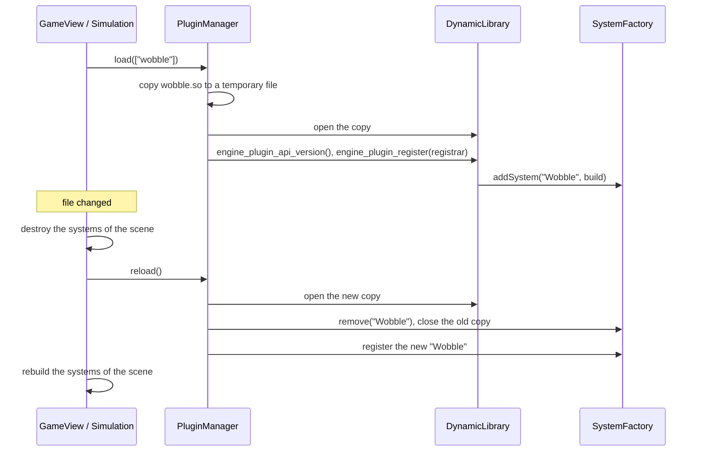

# Write a plugin

A plugin is a **shared library** (`.so` on Linux, `.dll` on Windows) that adds systems to the engine **without
rebuilding it**. A game lists the plugins it wants in its game file; the engine loads them at start, and
**reloads them while the game runs** when their file changes.

The repository ships one example, `plugins/wobble/`: a `Wobble` system that rocks the sprites of a texture. Skyhop
uses it on the plane of its menu.

## Why

| Benefit | Example |
|---|---|
| Extend the engine without touching it | A team or a modder adds systems with only the engine headers |
| Iterate fast | Change a system, rebuild only the plugin (seconds), the running game picks it up |
| Smaller core | A system needed by one game lives in a plugin instead of the engine |

This is the run-time level of modularity, on top of the compile-time options (`ENGINE_BUILD_CLIENT`,
`ENGINE_BUILD_SERVER`) and the link-time libraries ([Engine modules](../../architecture/engine-modules.md)).

## 1. Write the system

A plugin system is an ordinary engine system ([Add a system](add-a-system.md)) plus a static `build` function
that creates it from its JSON entry:

```cpp
class WobbleSystem : public engine::ecs::ISystem
{
public:
    static constexpr float DEFAULT_AMPLITUDE = 12.f;
    static constexpr float DEFAULT_SPEED = 3.f;

    WobbleSystem(engine::ecs::Registry &registry, std::string texture, float amplitude, float speed);

    void update(float dt) override;

    static std::unique_ptr<engine::ecs::ISystem> build(
        engine::scene::SystemContext &context, const engine::scene::DataNode &entry);
    ...
};
```

`build` reads the options of the entry (`{"system": "Wobble", "texture": "plane", "amplitude": 12}`) and gets
what it needs from the `SystemContext` (registry, UI store, renderer...).

## 2. Write the entry points

Every plugin exports two functions, with C linkage so the engine can find them by name. `ENGINE_PLUGIN_EXPORT`
(from `PluginRegistrar.hpp`) does that on both systems:

```cpp
#include "PluginRegistrar.hpp"
#include "WobbleSystem.hpp"

ENGINE_PLUGIN_EXPORT int engine_plugin_api_version()
{
    return engine::scene::PluginRegistrar::API_VERSION;
}

ENGINE_PLUGIN_EXPORT void engine_plugin_register(engine::scene::PluginRegistrar &registrar)
{
    registrar.addSystem("Wobble", &plugins::wobble::WobbleSystem::build);
}
```

| Function | Role |
|---|---|
| `engine_plugin_api_version` | Lets the engine refuse a plugin built against another version of the plugin API |
| `engine_plugin_register` | Declares the systems of the plugin, by name |

These two free functions are the only exception to the "classes only" convention: an entry point loaded by name
must be a C function.

## 3. Build it

In the root `CMakeLists.txt`:

```cmake
engine_add_plugin(wobble
    SOURCES plugins/wobble/src/WobbleSystem.cpp plugins/wobble/src/WobblePlugin.cpp
    INCLUDES plugins/wobble/include)

engine_add_game(skyhop
    LOCAL skyhop
    PLUGINS wobble
    ...)
```

`engine_add_plugin` builds `bin/plugins/wobble.so` (Linux) or `bin\Release\plugins\wobble.dll` (Windows).
`PLUGINS wobble` makes the game's build also build the plugin. Build the plugin alone with:

```sh
cmake --build build --target wobble                       # Linux
cmake --build out\windows --config Release --target wobble   # Windows
```

## 4. Use it in a game

In the game file, list the plugins, then use their systems like any other:

```json
"plugins": ["wobble"],
"scenes": {
    "menu": {
        "systems": ["Parallax", "Pointer", {"system": "Wobble", "texture": "plane", "amplitude": 12, "speed": 3}, "Audio"]
    }
}
```

A missing plugin stops the game at start with `PluginManager: plugin wobble not found at ...`.

## 5. Reload while the game runs

1. Start the game.
2. Change the plugin's code, for example `DEFAULT_SPEED` or the formula in `update`.
3. Rebuild only the plugin (`--target wobble`).
4. The game prints `[plugins] reloaded wobble` and uses the new code, without restarting.

The engine checks the plugin files twice per second and reloads one only when its file has stopped changing, so a
half-written file is never loaded. In R-Type, the console (F1) also has `plugins` (list the loaded plugins and
their systems) and `reload`.

## How it works



| Class | Folder | Role |
|---|---|---|
| `DynamicLibrary` | `core/` | Opens a `.so` or `.dll` and finds a function in it (hides `dlopen` and `LoadLibrary`) |
| `PluginRegistrar` | `scene/` | What a plugin receives to declare its systems |
| `LoadedPlugin` | `scene/` | One loaded plugin: file, systems, loaded version |
| `PluginManager` | `scene/` | Loads the plugins of a game, watches their files, reloads them |

The engine loads a **copy** of the library from a temporary folder. The original file therefore stays free to be
rebuilt, which matters on Windows, where a loaded DLL is locked.

## Rules

- **Plugins add systems, not new component types.** The engine's components cover the needs; a component type
  defined in a plugin could not survive its reload.
- **Build the plugin with the same compiler and the same engine** as the game. This is the usual rule for C++
  plugins: the plugin and the engine share their classes.
- A plugin is trusted code: it runs inside the game process with the same rights.
- Plugins are loaded by the client (scenes) and by the simulation (server and solo). Hot reload applies to the
  client scenes; the simulation loads its plugins when it starts.
