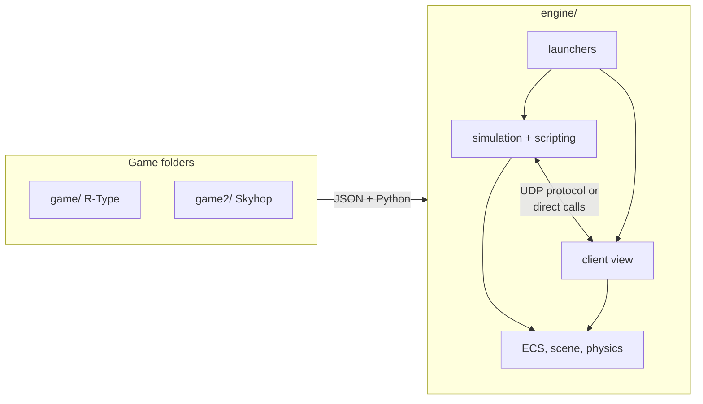

# R-Type documentation

This project is a **data-driven 2D game engine** written in C++20, and the games built on it:

- **R-Type**, a networked shoot'em up for up to four players, with lobby, rooms, three stages and their bosses;
- **Skyhop**, a solo one-button game, which shows that the engine is not tied to R-Type.

Games are made of JSON files and Python scripts only. The engine provides the ECS, physics, rendering, audio,
input, scripting, a binary UDP protocol with an authoritative server, and a solo mode.

## Where to start

| You want to... | Read |
|---|---|
| Build and play | [Quick start](getting-started/quick-start.md), [Installation](getting-started/installation.md), [Building](getting-started/building.md), [Running](getting-started/running.md), [Playing on a network](getting-started/network-play.md) |
| Join the team | [Onboarding](contributing/onboarding.md) |
| Understand the architecture | [Overview](architecture/overview.md), [Engine modules](architecture/engine-modules.md), [ECS](architecture/ecs.md) |
| Make content without C++ | [Create a game](guides/content/create-a-game.md), [Add an enemy](guides/content/add-an-enemy.md), [Scripting reference](reference/scripting-api.md) |
| Look up a component, a system or a JSON key | [Components](reference/components.md), [Systems](reference/systems.md), [Game file](reference/game-file.md) |
| Write a client for the server | [Network protocol (RFC)](reference/protocol.md) |
| See the network under delay and loss | [Network measurements](measurements/index.md) |
| Extend the engine | [Add a component](guides/engine/add-a-component.md), [Add a system](guides/engine/add-a-system.md), [Add a network message](guides/engine/add-a-network-message.md) |
| Know why it is built this way | [Design decisions](architecture/decisions.md), [Comparative study](comparative-study/index.md) |
| Fix a problem | [Troubleshooting](getting-started/troubleshooting.md), [Debugging](guides/engine/debugging.md), [FAQ](getting-started/faq.md) |

## Project at a glance



## Browse this documentation as a website

The pages are Markdown rendered with MkDocs Material (navigation, search, outline). From the repository root:

```sh
python3 -m venv .venv
. .venv/bin/activate
python -m pip install mkdocs-material
mkdocs serve
```

Open <http://127.0.0.1:8000>. `mkdocs build` produces the static site in `site/`, and `mkdocs gh-deploy`
publishes it on GitHub Pages.
